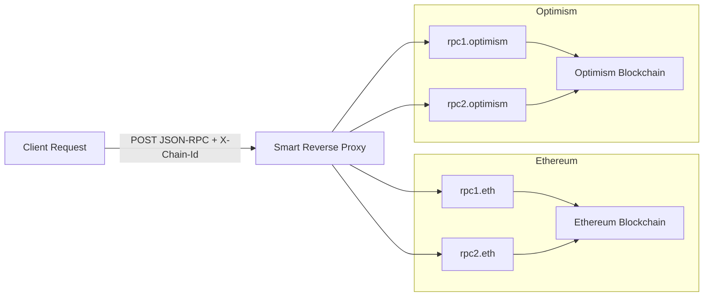

## Multi-Chain RPC Proxy

Multi-Chain RPC proxy routes requests to the best available provider based on real-time performance and health metrics.


### Quickstart:
- Make sure you have [Rust installed](https://rustup.rs/).
- Run ```cargo run``` or ```cargo run -- --log-level info```

This should be the expected output:

  

### DEV Mode:
When running devMode you will be mocking; the health endpoint of each provider and the rpc forward call. 
- Run ```cargo run - --dev```
  
### RPC Proxy Configuration

Multi-Chain RPC proxy uses a YAML configuration file to define the server settings and available blockchain providers. Below is an overview of how to use and structure the config file.
## Example Configuration

```yaml
host: "127.0.0.1"
port: 8080
blockchains:
   - id: eth
     name: Ethereum
     providers:
        - id: eth-p1
          name: Ethereum Provider1
          host: http://localhost
          port: 8545
          path: /health
          priority: 1
          default: false
        - id: eht-p2
          name: Ethereum Provider2
          host: http://localhost
          port: 8546
          path: /health
          priority: 20
          default: true
        - id: eht-p3
          name: Ethereum Provider3
          host: http://localhost
          port: 8546
          path: /health
          priority: 7
          default: true
   - id: op
     name: Optimism
     providers:
        - id: op-p1
          name: Optimism Provider1
          host: http://localhost
          port: 8545
          path: /health
          priority: 2
          default: true
        - id: op-p2
          name: Optimism Provider2
          host: http://localhost
          port: 8546
          path: /health
          priority: 1
          default: false
 ```    

## Endpoints:
- GET `/`
- GET `/metrics`
- POST `/rpc`

### Get  /
The GET `/` endpoint is a simple health check endpoint
#### Example
##### Request
```shell
curl curl http://localhost:8080/
```
##### Response
```shell
Multi-Chain RPC Proxy up!
```
### Get Metrics
The GET`/metrics` endpoint provides real-time health and ranking data for all configured blockchains and their respective providers.

#### Example

##### Request
```shell
curl curl http://localhost:8080/metrics
```

##### Response 
```json
{
  "blockchains": [
    {
      "id": "eth",
      "name": "Ethereum",
      "providers": [
        {
          "id": "eth-p1",
          "name": "Ethereum Provider1",
          "priority": 1,
          "default": false,
          "health": {
            "latency_ms": 232,
            "last_block": 111
          },
          "rank": {
            "score": 5293
          }
        },
        ...
      ]
    },
    ...
  ]
}
```

### POST RCP
The POST`/rpc` accepts incoming JSON POST requests representing JSON-RPC calls and forwards it to a target blockchain based on 
an `X-Chain-Id` `HTTP header` in the request: 
- The selected provider will depend on `calculate_score(latency, last_block, priority)` .
- The provider request will be catched according to a defined Time-To-Live (TTL).
- A default provider will be used in case of error when fetching the best provider. 

#### Example
##### Request
```shell
 curl -X POST http://localhost:8080/rpc \
  -H "Content-Type: application/json" \
  -H "X-Chain-Id: eth" \
  -d '{"jsonrpc":"2.0","method":"eth_blockNumber","params":[],"id":1}'
```
### Testing
- run ```cargo nextest run ```. You must have nextest installed:
   - ```cargo install cargo-nextest ```


