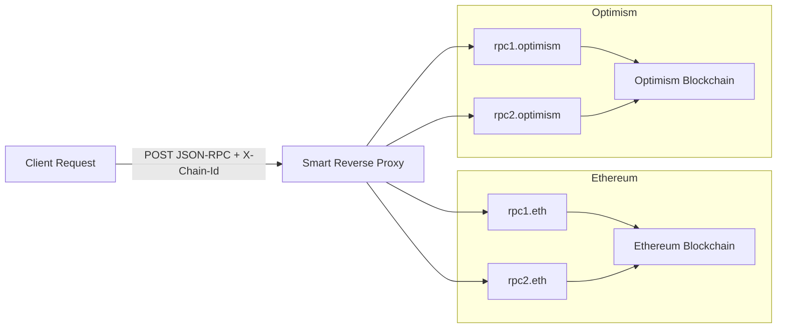

## Multi-Chain RPC Proxy

### **Context**

In Web3 infrastructure, reliable and high-performance access to blockchain data via RPCs is fundamental. While having multiple RPC providers offers basic failover to avoid Single Points of Failure (SPOF) and manage rate limits, simply falling back isn't always optimal. We can do better by intelligently routing requests to the *best* available provider based on real-time performance and health metrics.

### **Challenge**

Your task is to implement a high-performance Rust service that functions as a smart reverse proxy for JSON-RPC requests targeting EVM-compatible blockchains. It should intelligently route incoming requests to an optimal backend provider selected from a configured pool, considering various health and performance criteria across different chains.

### Requirements

1. **RPC Routing:**
    - Accept incoming JSON POST requests representing JSON-RPC calls.
    - Determine the target blockchain based on an `X-Chain-Id` HTTP header in the request or fallback to a default
    - Forward the request to a chosen backend RPC provider for that chain.
    - Handle cases where a requested `X-Chain-Id` has no configured RPCs.
2. **Provider Selection:**
    - Implement logic to rank available backend RPC providers for a given chain based on multiple criteria.
    - Consider at least three ranking factors:
        - Network Latency
        - Latest Block Height reported by the provider
        - A static Provider Priority (configured per provider)
    - Combine these factors using a weighted or similar algorithm to produce a final ranking.
3. **Provider Monitoring:**
    - Periodically monitor the health and gather necessary metrics (latency, block height) from all configured backend RPC providers concurrently.
    - Use these metrics to inform the ranking logic.
4. **Caching:**
    - Implement a simple in-memory cache for RPC responses to reduce redundant calls to backend providers.
    - Apply a Time-To-Live (TTL) to cache entries.
    - **Constraint:** The core cache logic (storage, expiry) must be implemented using standard Rust collections and concurrency primitives. **Do not rely on external caching crates or frameworks.**
5. **Metrics Endpoint:**
    - Provide a separate HTTP endpoint (e.g., `/metrics`) that exposes the current health status, metrics, and computed rankings for each chain

### Suggestions

You may want to take a look to the following crates:

- https://tokio.rs/
- https://docs.rs/thiserror/latest/thiserror/
- https://actix.rs/
- https://docs.rs/anyhow/latest/anyhow/

### Evaluation Criteria

At Wonderland we strive for excellence in every single thing we do. That’s why while looking at your challenge, besides working correctly, we will also take into account:

- **Idiomatic Rust & Safety:** Effective use of language features, ownership, borrowing, and concurrency primitives.
- **Best practices:** Handling of errors, provider failures, and edge cases.
- **Tests, Tests, and More Tests:** Thorough testing — not just unit tests, but also integration, and benchmarks for reliable, production-grade code will score significantly higher.
- **Documentation**: Does your README explain how to run your project and what it does? Is your code clear and explained?

### Deliverables

A GitHub repository containing the developed code, including instructions on how to set up and run the application.# rust-challenge
